# Model Context Protocol (MCP) Gateway

Tantra exposes an institutional-grade, Model Context Protocol (MCP) server that transforms the
entire Tantra trading and analytics engine into first-class tools for AI coding assistants
(Claude Code, Cursor, VS Code Copilot Agent mode, Gemini CLI) as well as the native `tantra-cli`
and `tantra-tui`.

The MCP server (`tantra-agent-mcp`) registers **22 tools — 6 base, 13 quantitative, 3 discovery**
— and ships over two transports:

- **stdio**: the `mcp_stdio_server` binary speaks JSON-RPC 2.0 over stdin/stdout. This is the
  transport used by locally spawned coding-agent integrations.
- **SSE/HTTP**: an Axum server exposes `/sse` (Server-Sent Events stream) and `/message`
  (JSON-RPC POST endpoint) for remote and web clients.

---

## 1. Core Architecture

Unlike standard API servers that overload the LLM context window with hundreds of static JSON
schemas, Tantra implements a **Two-Tier Gateway Discovery Protocol**:

```mermaid
flowchart LR
    Agent["Coding Agent\n(Claude Code / Cursor)"] -->|"1. tantra_search_tools"| GW["MCP Gateway"]
    GW -->|"Ranked matching tools"| Agent
    Agent -->|"2. tantra_describe_tool"| GW
    GW -->|"Exact JSON schema & bounds"| Agent
    Agent -->|"3. MCP tools/call\n(exact tool name)"| Engine["15 Quantitative Engines"]
    Engine -->|"Universal Result Envelope\n(tantra/result/v1)"| Agent
    Agent -->|"4. tantra_read_result\n($tantra/ref/&#60;uuid&#62;)"| GW
    GW -->|"Referenced data (paginated)"| Agent
```



- **Tier 1 — compact catalog.** The agent asks `tantra_search_tools` and receives a short ranked
  list of matching tool names, categories, and taglines. The catalog surface stays small — the
  gateway never advertises 100+ static schemas in `tools/list`.
- **Tier 2 — on-demand schema.** The agent asks `tantra_describe_tool` and receives the full
  JSON-Schema, parameter bounds, and mathematical specification for exactly one tool.
- **Invocation.** Tools are called through the **standard MCP `tools/call` method** using the
  exact tool name (e.g. `tantra_calc_statutory_costs`). There is no `tantra_call_tool`; the old
  dynamic dispatcher was replaced by the discovery trio in [§2](#2-gateway-discovery-tools).
- **Reference reads.** Large result payloads are not inlined; they are exported as
  `$tantra/ref/<uuid>` references and paged back with `tantra_read_result`. See the [Universal
  Result Protocol](result_protocol.md).

---

## 2. Gateway Discovery Tools

The gateway registers 3 discovery tools. Together with the base and quantitative tools they form
the full 22-tool surface.

### `tantra_search_tools`

Searches the quantitative catalog by natural-language query and category; returns ranked tool
names, categories, and taglines.

```json
{
  "query": "volatility regime",
  "category": "regimes"
}
```

`category` is an enum — `market | technicals | scanner | analytics | allocation | derivatives |
regimes | volatility | research | ledger | discovery | all` (default `all`).

### `tantra_describe_tool`

Fetches the full JSON-Schema, bounds, and mathematical specification for one tool:

```json
{
  "tool_name": "tantra_detect_regimes"
}
```

### `tantra_read_result`

Reads a previously exported data reference by its `$tantra/ref/<uuid>` URI, with offset/limit
pagination for large datasets:

```json
{
  "ref_id": "$tantra/ref/0192e8c4-0001-7a10-8000-9e3f8c1b2a4d",
  "offset": 0,
  "limit": 100
}
```

---

## 3. Universal Result Protocol (`tantra/result/v1`)

Every tool execution returns a structured, predictable result envelope:

```json
{
  "schema": "tantra/result/v1",
  "status": "ok",
  "meta": {
    "elapsed_ms": 12,
    "timestamp_ist": "2026-11-06T08:27:00+05:30",
    "version": "0.1.0",
    "precision": "exact_decimal_zero_floats"
  },
  "summary": "Delivery sale of ₹1,00,000 incurs ₹120.45 in total statutory charges.",
  "data": {
    "stt": "100.00",
    "exchange_charge": "3.45",
    "sebi_fee": "0.10",
    "stamp_duty": "0.00",
    "gst_18": "0.64",
    "total_statutory": "104.19"
  },
  "blocks": [
    {
      "type": "table",
      "title": "Statutory Charge Breakdown",
      "columns": ["Charge", "Rate", "Amount (INR)"],
      "rows": [
        ["STT (Delivery Sell)", "0.1%", "100.00"],
        ["NSE Exchange Fee", "0.00345%", "3.45"],
        ["SEBI Turnover Fee", "₹10/crore", "0.10"],
        ["GST", "18% on fees", "0.64"],
        ["Total Costs", "-", "104.19"]
      ]
    }
  ],
  "refs": {}
}
```

`meta.version` reports the gateway version, `meta.precision` is always
`exact_decimal_zero_floats`, and `refs` holds `$tantra/ref/<uuid>` pointers when a payload is too
large to inline. The full contract — envelope fields, `DisplayBlock` types, and reference
semantics — is documented in the [Universal Result Protocol](result_protocol.md).

## 4. Tool Catalog

The server registers 22 tools in three groups.

### 4.1 Base tools (6)

Base tools carry no `tantra_` prefix.

| Tool | Purpose | Key inputs |
|------|---------|------------|
| `get_indicator_catalog` | Returns the JSON vocabulary of approved indicators and acceptable parameter bounds. | none |
| `check_spec` | Validates strategy syntax and parameter ranges without running a backtest. | `strategy_manifest` |
| `run_backtest` | Dispatches a backtest to the honba-ya actor runtime. | `strategy_manifest`, `run_config` |
| `evaluate_metrics` | Computes un-cherrypicked statistics: Sharpe, Sortino, Max Drawdown, Win Rate, OTR, DSR, PBO. | `trade_log[]`, `risk_engine_state`, `config` |
| `optimize_strategy` | Triggers a genetic or Bayesian parameter sweep. | `strategy_manifest`, `optimization_config` |
| `explain_decision` | Returns the exact prompt, market context, and risk checks for a historical trade decision. | `decision`, `market_context`, `risk_check_results[]` |

**`strategy_manifest`** (shared by `check_spec`, `run_backtest`, `optimize_strategy`):

```json
{
  "name": "nifty_momentum",
  "api_version": "1",
  "driving_timeframe": { "aggregation": "time", "interval": "1D" },
  "parameters": { "lookback": 20 },
  "warmup_bars": 50,
  "indicators": ["sma", "rsi"]
}
```

!!! note
    Field values above are illustrative. Indicator names and parameter bounds must come from
    `get_indicator_catalog`; unknown indicators or out-of-range parameters are rejected by
    `check_spec`.

**`run_config`** (for `run_backtest`):

```json
{
  "seed": 42,
  "account": { "starting_cash": "1000000", "currency": "INR" },
  "execution": {
    "cost_model_version": "2026-11",
    "fill_model": "ioc",
    "apply_statutory_costs": true,
    "t_plus_1_settlement": true
  }
}
```

**`evaluate_metrics`** — `trade_log` entries carry `timestamp`, `instrument`, `side`,
`quantity`, `price`, `pnl`; `config` sets `risk_free_rate` (default `0.06`), `periods_per_year`
(default `252`), and `num_trials`:

```json
{
  "trade_log": [
    {
      "timestamp": "2026-11-06T09:30:00+05:30",
      "instrument": "NSE:RELIANCE-EQ",
      "side": "buy",
      "quantity": "10",
      "price": "2800.00",
      "pnl": "1250.00"
    }
  ],
  "risk_engine_state": {},
  "config": { "risk_free_rate": "0.06", "periods_per_year": 252, "num_trials": 1000 }
}
```

**`optimize_strategy`** — `optimization_config.algorithm` is `genetic` or `bayesian`:

```json
{
  "strategy_manifest": {
    "name": "nifty_momentum",
    "api_version": "1",
    "driving_timeframe": { "aggregation": "time", "interval": "1D" },
    "parameters": { "lookback": 20 },
    "warmup_bars": 50,
    "indicators": ["sma", "rsi"]
  },
  "optimization_config": { "algorithm": "genetic", "trials": 100, "seed": 7 }
}
```

**`explain_decision`** — returns the exact prompt, market context, and risk checks for a
historical decision:

```json
{
  "decision": {
    "action": "buy",
    "symbol": "NSE:RELIANCE-EQ",
    "qty": "10",
    "price_limit": "2800.00",
    "algo_id": "IN0000000000000000"
  },
  "market_context": {},
  "risk_check_results": []
}
```

### 4.2 Quantitative tools (13)

Quantitative tools carry the `tantra_` prefix and are grouped by engine category. Every one
accepts an optional `_jq` string — a JSONPath filter applied server-side to the response payload
before serialization (token-optimization feature, plan 0007 Ph 15).

| Tool | Category | Purpose |
|------|----------|---------|
| `tantra_forecast_series` | forecast | Theta/ETS/Holt-Winters/ARIMA/TBATS/gradient-boost point forecasts plus prediction interval. |
| `tantra_monte_carlo` | analytics | Stationary moving-block bootstrap equity paths; drawdowns, ruin probabilities, stability. |
| `tantra_cointegration` | analytics | Engle-Granger two-step test; hedge ratio, ADF statistic, spread z-score. |
| `tantra_walk_forward` | analytics | Walk-Forward Efficiency (WFE) via IS/OOS split. |
| `tantra_factor_attribution` | analytics | Decomposes returns into systematic factor exposures plus idiosyncratic residual risk. |
| `tantra_portfolio_optimize` | allocation | Mean-Variance tangency, Risk Parity (equal risk contribution), or HRP. |
| `tantra_multi_period_optimize` | allocation | MPO rebalance sequence over T periods with quadratic transaction costs and linear turnover penalty. |
| `tantra_detect_regimes` | regimes | Gaussian hidden Markov model (Baum-Welch + Viterbi); labels observations bullish/bearish/choppy_volatile. |
| `tantra_change_point` | analytics | Two-sided CUSUM structural-break scan. |
| `tantra_copula_tail_risk` | analytics | Bivariate Clayton/Gumbel copula; Kendall tau, tail dependence, bootstrap joint VaR95. |
| `tantra_permutation_test` | analytics | Sharpe-ratio permutation test; sign-flip p-value. |
| `tantra_price_derivatives` | derivatives | Black-Scholes-Merton price plus analytic Greeks (Delta, Gamma, Vega, Theta, Rho). |
| `tantra_garch_volatility` | volatility | GARCH(1,1) fit; conditional volatility forecasts, half-life, persistence. |

Input schemas:

**`tantra_forecast_series`** — `series[]` and `horizon` (≥ 1) required; `model` is an enum
(`theta | ets | holt_winters | arima | tbats | gradient_boost`); ARIMA uses `p`/`d`/`q`,
gradient boost uses `lags`/`n_estimators`/`max_depth`/`learning_rate`:

```json
{
  "series": ["1.5", "1.8", "2.1", "1.9", "2.4"],
  "horizon": 5,
  "model": "theta",
  "seasonal_period": 5
}
```

**`tantra_monte_carlo`** — `returns[]` required; `num_sims` min 10 (default 500), `horizon` ≥ 1:

```json
{
  "returns": ["0.001", "-0.002", "0.003", "0.001"],
  "num_sims": 500,
  "horizon": 252
}
```

**`tantra_cointegration`** — `series_x[]` and `series_y[]` required:

```json
{
  "series_x": ["1.0", "1.1", "1.2"],
  "series_y": ["2.0", "2.2", "2.4"]
}
```

**`tantra_walk_forward`** — `returns[]` required; `train_size` ≥ 1, `test_size` ≥ 1:

```json
{
  "returns": ["0.001", "-0.002", "0.003", "0.001", "0.002"],
  "train_size": 1260,
  "test_size": 252
}
```

**`tantra_factor_attribution`** — `factor_returns` (object) required; `holdings[]` optional,
`annualization_factor` default 252:

```json
{
  "asset_returns": ["0.001", "-0.002", "0.003"],
  "factor_returns": { "market": ["0.002", "0.001", "0.004"] },
  "holdings": [],
  "annualization_factor": 252
}
```

**`tantra_portfolio_optimize`** — `covariance_matrix[][]` required; `objective` is
`mean_variance | risk_parity | hrp` (default `mean_variance`); `weight_bounds[]` are per-asset
min/max pairs:

```json
{
  "expected_returns": ["0.12", "0.08"],
  "covariance_matrix": [["0.04", "0.01"], ["0.01", "0.02"]],
  "objective": "mean_variance",
  "target_return": "0.10",
  "risk_free_rate": "0.00",
  "symbols": ["NSE:RELIANCE-EQ", "NSE:TCS-EQ"],
  "weight_bounds": [["0.0", "1.0"], ["0.0", "1.0"]]
}
```

**`tantra_multi_period_optimize`** — same matrix inputs; defaults `objective` `risk_parity`,
`periods` 3, `transaction_cost` 0.001, `turnover_penalty` 0.0001:

```json
{
  "expected_returns": ["0.12", "0.08"],
  "covariance_matrix": [["0.04", "0.01"], ["0.01", "0.02"]],
  "objective": "risk_parity",
  "periods": 3,
  "transaction_cost": "0.001",
  "turnover_penalty": "0.0001",
  "max_turnover_per_period": "0.05",
  "symbols": ["NSE:RELIANCE-EQ", "NSE:TCS-EQ"],
  "weight_bounds": [["0.0", "1.0"], ["0.0", "1.0"]]
}
```

**`tantra_detect_regimes`** — `returns[]` required; `n_states` is `2 | 3` (default 2):

```json
{
  "returns": ["0.001", "-0.002", "0.003", "0.001", "0.002", "-0.004"],
  "n_states": 2,
  "max_iterations": 100
}
```

**`tantra_change_point`** — `series[]` required; defaults `min_observations` 10,
`threshold_multiplier` 3.0, `min_segment` 5:

```json
{
  "series": ["1.0", "1.1", "1.2", "2.0", "2.1", "2.2"],
  "min_observations": 10,
  "threshold_multiplier": "3.0",
  "min_segment": 5
}
```

**`tantra_copula_tail_risk`** — `series_x[]` and `series_y[]` required; `family` is
`clayton | gumbel` (default `clayton`), `n_simulations` default 5000, `seed` default 42:

```json
{
  "series_x": ["1.0", "1.1", "1.2"],
  "series_y": ["2.0", "2.2", "2.4"],
  "family": "clayton",
  "n_simulations": 5000,
  "seed": 42
}
```

**`tantra_permutation_test`** — `returns[]` required; defaults `n_permutations` 1000, `seed` 42:

```json
{
  "returns": ["0.001", "-0.002", "0.003", "0.001"],
  "n_permutations": 1000,
  "seed": 42
}
```

**`tantra_price_derivatives`** — `spot`, `strike`, `t_years`, `risk_free_rate`, `volatility`, and
`option_type` (`call | put`) required; `dividend_yield` default 0:

```json
{
  "spot": "24800.00",
  "strike": "25000.00",
  "t_years": "0.25",
  "risk_free_rate": "0.065",
  "volatility": "0.15",
  "option_type": "call",
  "dividend_yield": "0.00"
}
```

**`tantra_garch_volatility`** — `returns[]` required; defaults `p` 1, `q` 1,
`forecast_horizon` 5, `annualization` 252:

```json
{
  "returns": ["0.001", "-0.002", "0.003", "0.001"],
  "p": 1,
  "q": 1,
  "forecast_horizon": 5,
  "annualization": 252
}
```

## 5. Quantitative Engines

Tantra groups its analytical capabilities into 15 domain engines. Each engine has a dedicated
toolset reference:

| Engine | Description |
|--------|-------------|
| [market](toolsets/market.md) | Real-time quotes, OHLCV candles, order books, holiday calendars. |
| [technicals](toolsets/technicals.md) | 200+ indicators (RSI, MACD, Bollinger Bands) and 61 candlestick patterns. |
| [scanner](toolsets/scanner.md) | Screening across 4,000 fields for Indian equities and derivatives. |
| [analytics](toolsets/analytics.md) | Performance tearsheets, Sharpe, Sortino, drawdowns, rolling statistics. |
| [validation](toolsets/validation.md) | Deflated Sharpe Ratio (DSR), Probability of Backtest Overfitting (PBO). |
| [allocation](toolsets/allocation.md) | Mean-variance optimization, Hierarchical Risk Parity (HRP), Black-Litterman. |
| [risk](toolsets/risk.md) | Pre-trade SEBI margin checks, VaR, Expected Shortfall (CVaR). |
| [regimes](toolsets/regimes.md) | Hidden Markov Models (2-state and 3-state calm/turbulent regime detection). |
| [volatility](toolsets/volatility.md) | GARCH family modeling, realized volatility, volatility cones. |
| [ledger](toolsets/ledger.md) | Tax lot matching (FIFO, LIFO) and Section 112A capital gains computation. |
| [calc](toolsets/calc.md) | Indian statutory costs (STT, GST, Stamp Duty, Exchange Charges). |
| [research](toolsets/research.md) | Genetic strategy generation and closed-loop mutation. |
| [backtest](toolsets/backtest.md) | High-performance backtesting runtime with market impact and slippage. |
| [forecast](toolsets/forecast.md) | Time-series point forecasts and prediction intervals (Theta, ETS, Holt-Winters, ARIMA, TBATS, gradient boost). |
| [derivatives](toolsets/derivatives.md) | Options pricing and analytics (Black-Scholes-Merton price and Greeks). |

See the [Quantitative Toolsets index](../ai/toolsets/index.md) for the catalog of every engine.

---

## 6. Safety Invariants

1. **Zero Floats Rule**: All prices, margins, ratios, and taxes are strictly exact decimal
   (`rust_decimal::Decimal`). No `f32`/`f64`/`float` ever appears in a price, quantity, cash
   balance, statutory tax, or margin calculation; JSON payloads carry these as decimal strings
   and `meta.precision` is always `exact_decimal_zero_floats`.
2. **NoFX Untrusted AI Principle**: AI tools are advisory and read-only. AI models propose
   signals; they can never place unsupervised live orders or bypass the deterministic
   `tantra-risk` engine. Decisions conform to `tantra_core::Decision` parsed with
   `#[serde(deny_unknown_fields)]`, and a synchronous, non-bypassable pre-trade risk gate clamps
   every decision (SEBI `algo_id`, OTR circuit breakers, price bands, freeze limits) before it
   reaches execution.
3. **Indian Market Specialization**: Native support for NSE/BSE holidays, IST timezone
   (`Asia/Kolkata`), SEBI statutory fees (STT, GST, Stamp Duty, Exchange Charges), F&O contract
   specifications, and T+1 settlement accounting.

---

## 7. Connecting Coding Agents

Tantra provides one-click configuration export via the CLI. One command per client writes the
correct `mcpServers` block:

| Client | Command | Config file |
|--------|---------|-------------|
| [Claude Code](clients/claude_code.md) | `tantra mcp config --client claude-code` | `~/.claude.json` |
| [Cursor](clients/cursor.md) | `tantra mcp config --client cursor` | `.cursor/mcp.json` |
| [VS Code (Copilot Agent)](clients/vs_code.md) | `tantra mcp config --client vscode` | `.vscode/mcp.json` |
| [Gemini CLI](clients/gemini.md) | `tantra mcp config --client gemini` | generated via `generate_gemini_cli` |

Every config points the client at the stdio transport:

```json
{
  "mcpServers": {
    "tantra": {
      "command": "tantra",
      "args": ["mcp", "--stdio"]
    }
  }
}
```

---

## 8. Verification

Confirm the gateway is live and addressable:

1. Check `tools/list` in your client — it should show 22 tools.
2. Query the catalog through the CLI gateway:

```bash
tantra tools search "GARCH volatility"
```

3. Pull a full schema and run a tool:

```bash
tantra tools describe tantra_garch_volatility
tantra tools call tantra_garch_volatility '{"returns": ["0.001", "-0.002", "0.003", "0.001"], "forecast_horizon": 5}'
```

Every response is a `tantra/result/v1` envelope with `status: "ok"` (see the [Universal Result
Protocol](result_protocol.md)).

---

## 9. Canonical Workflows

The gateway is designed around end-to-end research tasks. Three canonical workflows:

### Momentum validation (walk-forward Sharpe + DSR)

Prompt: *"Calculate walk-forward Sharpe and DSR for Momentum strategy on NIFTY 50."*

1. `check_spec` — validate the momentum `strategy_manifest` (driving timeframe on
   `NSE:NIFTY50-INDEX`, indicators from `get_indicator_catalog`).
2. `run_backtest` — backtest with statutory costs applied and T+1 settlement enabled.
3. `tantra_walk_forward` — IS/OOS split of the strategy's `returns[]` for Walk-Forward
   Efficiency.
4. `evaluate_metrics` — un-cherrypicked Sharpe, Sortino, Max Drawdown, Win Rate, OTR, DSR, PBO
   from the `trade_log`.

### Breakout scan plus delivery statutory charges

Prompt: *"Scan for breakout candidates with RSI > 60 and calculate exact delivery statutory
charges."*

1. `tantra_search_tools` — query `"breakout scanner RSI"` with `category: "scanner"`.
2. Run the scanner/technicals tool (see the [scanner](toolsets/scanner.md) toolset) with the
   RSI > 60 filter.
3. `tantra_calc_statutory_costs` — exact delivery statutory charges (STT, exchange charges,
   SEBI fees, stamp duty, GST) for the shortlist.

### Regime classification

Prompt: *"Fit a 2-state Hidden Markov Model on BANKNIFTY returns to classify the current
volatility regime."*

1. `tantra_describe_tool` — pull the full spec and bounds for `tantra_detect_regimes`.
2. `tantra_detect_regimes` — `returns[]` from BANKNIFTY, `n_states: 2`, `max_iterations: 100`.
3. Read the bullish/bearish/choppy_volatile labels from the `tantra/result/v1` payload.

---

Continue to the [Universal Result Protocol](result_protocol.md) for the response contract, the
[Quantitative Toolsets index](../ai/toolsets/index.md) for the engines, or the [MCP
Quickstart](../getting-started/mcp.md) to get a client connected in minutes.


