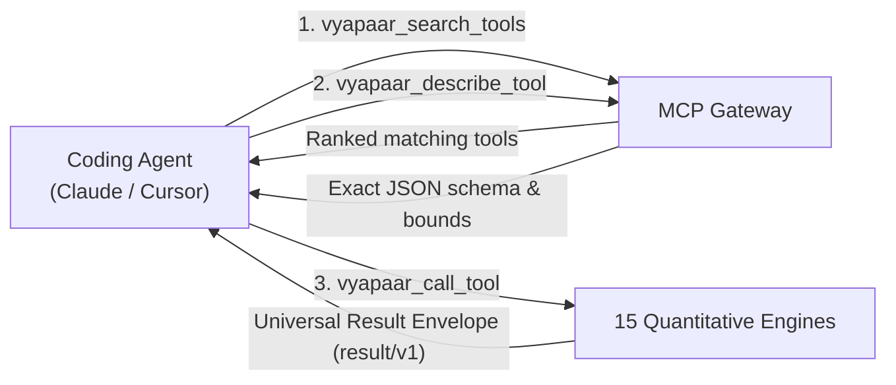

# Model Context Protocol (MCP) Gateway

Vyapaar exposes an institutional-grade, Model Context Protocol (MCP) server that transforms the entire Vyapaar trading and analytics engine into first-class tools for AI coding assistants (Claude Code, Cursor, GitHub Copilot, Codex, Gemini CLI) as well as the native `vyapaar-cli` and `vyapaar-tui`.

---

## 1. Core Architecture

Unlike standard API servers that overload the LLM context window with hundreds of static JSON schemas, Vyapaar implements a **Two-Tier Gateway Discovery Protocol**:



### Safety Invariants
1. **Zero Floats Rule**: All prices, margins, ratios, and taxes are strictly exact decimal (`rust_decimal::Decimal`).
2. **NoFX Untrusted AI Principle**: AI tools are advisory and read-only. AI models propose signals; they can never place unsupervised live orders or bypass the deterministic `vyapaar-risk` engine.
3. **Indian Market Specialization**: Native support for NSE/BSE holidays, IST timezone (`Asia/Kolkata`), SEBI statutory fees (STT, GST, Stamp Duty, Exchange Charges), and F&O contract specifications.

---

## 2. Gateway Discovery Tools

By default, the MCP server registers 3 primary gateway tools to keep startup context overhead minimal:

### `vyapaar_search_tools`
Searches the quantitative catalog by query and category:
```json
{
  "query": "volatility regime",
  "category": "regimes"
}
```

### `vyapaar_describe_tool`
Fetches the full JSON-Schema, bounds, and mathematical specifications on demand:
```json
{
  "tool_name": "vyapaar_regime_check"
}
```

### `vyapaar_call_tool`
Dynamically dispatches tool calls when dynamic schema invocation is preferred:
```json
{
  "tool_name": "vyapaar_calc_statutory_costs",
  "arguments": {
    "segment": "equity_delivery",
    "turnover": "100000",
    "side": "sell"
  }
}
```

---

## 3. Universal Result Protocol (`vyapaar/result/v1`)

Every tool execution returns a structured, predictable result envelope:

```json
{
  "schema": "vyapaar/result/v1",
  "status": "ok",
  "meta": {
    "elapsed_ms": 12,
    "timestamp_ist": "2026-11-06T08:27:00+05:30",
    "precision": "exact_decimal_zero_floats"
  },
  "summary": "Delivery sale of ₹1,00,000 incurs ₹120.45 in total statutory charges.",
  "data": {
    "stt": "100.00",
    "exchange_charge": "3.45",
    "sebi_fee": "0.10",
    "stamp_duty": "0.00",
    "gst_18": "0.64",
    "total_statutory": "104.19"
  },
  "blocks": [
    {
      "type": "table",
      "title": "Statutory Charge Breakdown",
      "columns": ["Charge", "Rate", "Amount (INR)"],
      "rows": [
        ["STT (Delivery Sell)", "0.1%", "100.00"],
        ["NSE Exchange Fee", "0.00345%", "3.45"],
        ["SEBI Turnover Fee", "₹10/crore", "0.10"],
        ["GST", "18% on fees", "0.64"],
        ["Total Costs", "-", "104.19"]
      ]
    }
  ]
}
```

---

## 4. Connecting Coding Agents

Vyapaar provides one-click configuration export via the CLI:

### Claude Code
```bash
vyapaar mcp config --client claude-code
```
Writes to `~/.claude.json`:
```json
{
  "mcpServers": {
    "vyapaar": {
      "command": "vyapaar",
      "args": ["mcp", "--stdio"]
    }
  }
}
```

### Cursor
```bash
vyapaar mcp config --client cursor
```
Writes to `.cursor/mcp.json` in the current project workspace.

### VS Code (Copilot Agent Mode)
```bash
vyapaar mcp config --client vscode
```

---

## 5. Quantitative Engines

Vyapaar groups its analytical capabilities into 15 domain engines:
- **`market`**: Real-time quotes, OHLCV candles, order books, holiday calendars.
- **`technicals`**: 200+ indicators (RSI, MACD, Bollinger Bands) and 61 candlestick patterns.
- **`scanner`**: Screening across 4,000 fields for Indian equities and derivatives.
- **`analytics`**: Performance tearsheets, Sharpe, Sortino, drawdowns, rolling statistics.
- **`validation`**: Deflated Sharpe Ratio (DSR), Probability of Backtest Overfitting (PBO).
- **`allocation`**: Mean-variance optimization, Hierarchical Risk Parity (HRP), Black-Litterman.
- **`risk`**: Pre-trade SEBI margin checks, VaR, Expected Shortfall (CVaR).
- **`regimes`**: Hidden Markov Models (2-state and 3-state calm/turbulent regime detection).
- **`volatility`**: GARCH family modeling, realized volatility, volatility cones.
- **`ledger`**: Tax lot matching (FIFO, LIFO) and Section 112A capital gains computation.
- **`calc`**: Indian statutory costs (STT, GST, Stamp Duty, Exchange Charges).
- **`research`**: Genetic strategy generation and closed-loop mutation.
- **`backtest`**: High-performance backtesting runtime with market impact and slippage.
